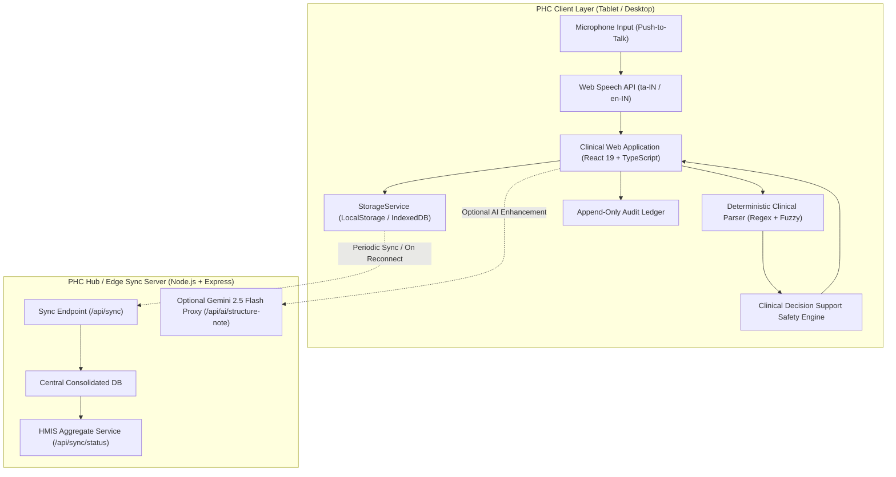
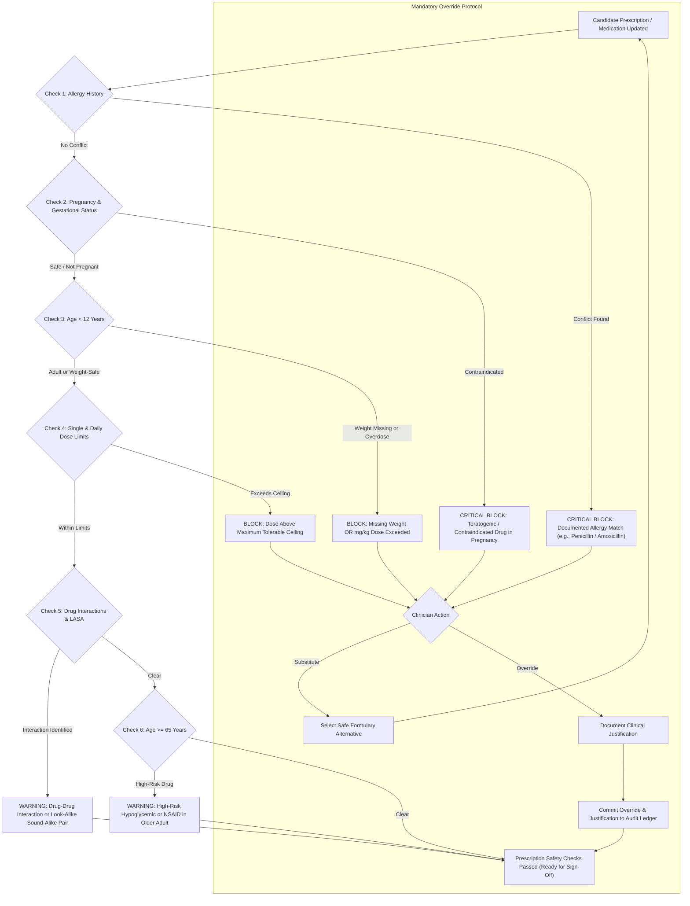
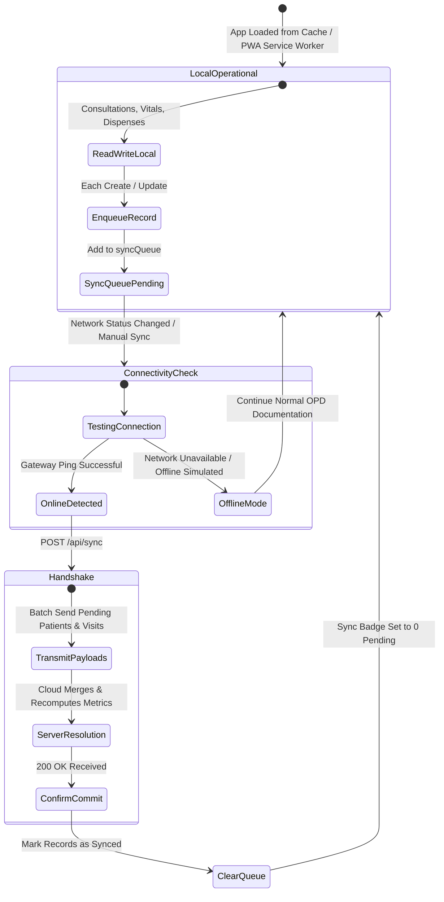

# Arogya Voice Scribe: Clinical & Technical Workflow Specification

Built for the **TCS iON Hackathon**  
System: Primary Health Centre AI Scribe & Clinical Decision Support System  
Document Version: 1.0 (Production Architecture)

---

## 1. System Architecture Overview

The Arogya Voice Scribe system operates as an offline-first single-page web application paired with an optional local sync service. It is designed to function smoothly even when rural Primary Health Centres experience intermittent or non-existent internet connectivity.



---

## 2. End-to-End Clinical Consultation Journey

The primary health centre patient encounter proceeds through five sequential stations:

```mermaid
sequenceDiagram
    autonumber
    actor Patient as Patient / Attendant
    actor Nurse as Staff Nurse / ANM
    actor Doctor as Medical Officer (Doctor)
    actor Pharmacist as PHC Pharmacist
    participant System as Arogya Voice Scribe System
    participant CentralDB as PHC Sync Hub

    %% Station 1: Registration & Triage
    rect rgb(240, 248, 255)
    Note over Patient, Nurse: Station 1: Patient Triage & Vitals Intake
    Patient->>Nurse: Presents at OPD Reception
    Nurse->>System: Lookup via Phone / Scan QR / Register New Patient
    System-->>Nurse: Displays Demographics & Historical Visits
    Nurse->>System: Enters BP, Pulse, Temp, SpO2, Weight, Blood Sugar
    System->>System: Evaluates Triage Thresholds (Normal / Amber / Urgent Red)
    System-->>Nurse: Flags Urgent Vitals (e.g., SpO2 < 90% prompts Referral suggestion)
    Nurse->>System: Saves Vitals & Generates Patient Token
    end

    %% Station 2: Doctor Consultation
    rect rgb(245, 255, 245)
    Note over Patient, Doctor: Station 2: Medical Consultation & Dictation
    Patient->>Doctor: Enters Consultation Room with Token / QR Card
    Doctor->>System: Scans QR / Selects Patient from Active Queue
    System-->>Doctor: Renders 1-Page Summary: Allergies (Red), Chronic Conditions, Past Visits
    Doctor->>Doctor: Examines Patient; Obtains Consent
    Doctor->>System: Holds Push-to-Talk Mic; Speaks Clinical Summary in Tamil/English
    System->>System: Captures Audio; Streams Interim Transcription Live
    Doctor->>System: Releases Mic; Initiates Clinical Parsing
    System->>System: Executes Deterministic Extraction (Complaints, Vitals, ICD-10, Meds)
    System->>System: Runs Multi-Tier Safety Engine against Demographics, Allergies & Vitals
    alt Critical Safety Violation Detected (e.g., Allergy Conflict or Pregnancy Risk)
        System-->>Doctor: Triggers Critical Block Modal; Disables Approval Button
        Doctor->>System: Modifies Drug Choice OR Enters Mandatory Override Justification
        System->>System: Logs Override Justification to Append-Only Audit Trail
    else No Critical Violations
        System-->>Doctor: Highlights Extracted Fields with Token Confidence (Green/Amber/Red)
    end
    Doctor->>System: Verifies High-Risk Fields (Diagnosis, Drugs, Dosages)
    Doctor->>System: Enters Security PIN to Authorize & Lock Record
    System->>System: Halts Documentation Stopwatch; Saves Elapsed Time Metric
    System-->>Doctor: Generates Bilingual A4/A5 Prescription & Referral Note
    Doctor->>Patient: Hands Printed Bilingual Prescription / Referral
    end

    %% Station 3: Pharmacy Dispensing
    rect rgb(255, 250, 240)
    Note over Patient, Pharmacist: Station 3: Pharmacy Verification & Dispensing
    Patient->>Pharmacist: Presents Printed Prescription / Scans QR
    Pharmacist->>System: Opens Pharmacy Dispense Queue
    System-->>Pharmacist: Displays Doctor-Approved Prescription Items
    loop Each Medication
        Pharmacist->>System: Verifies Stock; Ticks Off Dispensed Item
    end
    Pharmacist->>System: Confirms Dispensing Completed
    System->>System: Commits Dispense Event to Audit Trail
    Pharmacist->>Patient: Dispenses Medications with Tamil Label Directions
    end

    %% Station 4: Synchronization
    rect rgb(248, 240, 255)
    Note over System, CentralDB: Station 4: Offline Aggregation & District Reporting
    System->>CentralDB: Transmits Encrypted Visit Payloads via /api/sync
    CentralDB->>CentralDB: Commits Records; Recomputes HMIS Indicators (NCD, ANC, ARI)
    CentralDB-->>System: Confirms Sync State; Updates Synced Status Flag
    end
```

---

## 3. Voice-to-Structured-Note Processing Pipeline

The natural language processing pipeline is deterministic, local-first, and transparent:

```mermaid
flowchart TD
    RawVoice["1. Spoken Audio Stream (Tamil / English / Tanglish)"]
    WebSpeech["2. Web Speech API (ta-IN / en-IN)"]
    RawTranscript["3. Raw Transcription String"]
    
    subgraph Normalization["Phonetic & Linguistic Normalization"]
        TamilDigits["Convert Tamil Digits (௧-௯) to Arabic Numerals"]
        TamilWords["Normalize Tamil Number Words (ஒன்று->1, இரண்டு->2)"]
        UnitStandard["Standardize Units (மிலிகிராம்->mg, மிலி->ml, g, mcg)"]
        Punctuation["Split at Punctuation, 'and', 'மற்றும்'"]
    end

    subgraph Extraction["Deterministic Rule-Based Extraction"]
        VitalsExt["Extract Vitals: BP regex, Pulse regex, Temp regex, Sugar regex"]
        ComplaintsExt["Extract Chief Complaints: Exact dictionary match with Tamil/English lookup"]
        IcdExt["Map Diagnosis: Match PHC ICD-10 registry; assign ICD-10 code"]
        MedsExt["Extract Medications: Formulary lookup, dosage regex, frequency (1-1-1/BD/TDS/SOS)"]
        TimingExt["Extract Food Relation (உணவுக்குப் பின்/முன்) & Course Duration (நாட்கள்)"]
        ReferralExt["Extract Referral Request, Target Facility, and Reason"]
    end

    subgraph Scoring["Token Confidence & Traceability"]
        ExactMatch["Exact Formulary / Dictionary Match: Confidence 1.0 (Green)"]
        FuzzyMatch["Levenshtein Distance >= 0.85: Confidence 0.85 (Amber / Review Required)"]
        Unmatched["Unrecognized Input: Confidence < 0.60 (Red / Kept as Raw Free Text)"]
    end

    subgraph DoctorReview["Human-in-the-Loop Sign-Off"]
        InteractiveEdit["Doctor Reviews & Edits Fields"]
        PinApprove["PIN Authorization Locks Note"]
    end

    RawVoice --> WebSpeech
    WebSpeech --> RawTranscript
    RawTranscript --> Normalization
    Normalization --> Extraction
    Extraction --> Scoring
    Scoring --> InteractiveEdit
    InteractiveEdit --> PinApprove
```



---

## 4. Clinical Safety Engine Decision Logic

Every medication addition, dosage modification, or vital sign update triggers an instantaneous re-evaluation of the clinical safety rules:



---

## 5. Offline-First Storage & Cloud Synchronization Protocol

Arogya Voice Scribe is architecturally resilient against network drops. The following state machine governs data persistence and synchronization:



---

## 6. Role-Based Access Control (RBAC) Matrix

| System Module / Screen | Medical Officer (Doctor) | Staff Nurse / ANM | Pharmacist |
|---|---|---|---|
| **Patient Registration & QR Card Issuance** | Permitted | Permitted | Read-Only |
| **Nurse Intake & Vitals Station** | Permitted | Permitted | Read-Only |
| **Comprehensive Patient History Summary** | Full Access | Summary Access | Prescription Only |
| **Push-to-Talk Voice Dictation** | Full Access | Not Permitted | Not Permitted |
| **Structured Note Editing & ICD-10 Coding** | Full Access | Not Permitted | Not Permitted |
| **Clinical Safety Override Authorization** | Permitted (Documented Justification Required) | Not Permitted | Not Permitted |
| **Prescription Digital Signature & Approval** | Permitted (PIN Required) | Not Permitted | Not Permitted |
| **Bilingual Prescription & Referral Print** | Permitted | Permitted (After Doctor Sign-Off) | Permitted (After Doctor Sign-Off) |
| **Pharmacy Dispense Queue & Label Printing** | Read-Only | Read-Only | Full Access |
| **HMIS Aggregate Reporting & Analytics** | Full Analytics & Export | Aggregated Counts Only | Dispense Metrics Only |
| **Append-Only Clinical Audit Log** | Full Inspection (Read-Only) | Not Permitted | Not Permitted |

---

## 7. Emergency & Edge Case Protocols

### 7.1 Microphone Unavailable or Browser Speech Denied
- **Trigger**: Browser speech recognition permissions blocked or unsupported hardware.
- **Protocol**: System detects lack of `SpeechRecognition` support within 200ms, immediately displays an informational banner, and transitions the UI to the manual keyboard transcription buffer without disrupting the consultation flow.

### 7.2 Sudden Network Disconnection During Active Consultation
- **Trigger**: Loss of local Wi-Fi or cellular network while doctor is dictating or approving a visit.
- **Protocol**: All application assets, drug formularies, ICD-10 registries, and patient records remain loaded locally. The application flags the status badge as **Offline (Local Mode)**. Records are committed to IndexedDB/LocalStorage with `isSynced: false` and queued for background dispatch. No clinical data is lost.

### 7.3 Critical Anaphylactic Drug Conflict
- **Trigger**: Doctor dictates or selects a drug belonging to a documented allergy class (e.g., Amoxicillin for a patient with documented Penicillin hives/anaphylaxis).
- **Protocol**: The Safety Engine immediately surfaces a high-priority red alert banner and disables the electronic signature button. The doctor must either replace the drug with a recommended alternative (e.g., Azithromycin) or enter a formal clinical override reason. Both the conflict and the override rationale are indelibly written to the audit log.

### 7.4 Critical Vital Sign Triage (e.g., Severe Hypoxemia)
- **Trigger**: Nurse or doctor enters vital signs crossing urgent thresholds (e.g., SpO2 < 90%, BP >= 180/120 mmHg, or Pulse > 130 bpm).
- **Protocol**: The system triggers an urgent referral recommendation banner and pre-populates the secondary referral panel, recommending immediate escalation to a Taluk or District Headquarter Hospital.

---

## 8. Acknowledgements

We express our sincere thanks to **Tata Consultancy Services (TCS)** and the **TCS iON Hackathon** leadership team for establishing a forward-looking hackathon theme that focuses on high-impact public healthcare challenges.

Developing Arogya Voice Scribe against this specification has allowed us to demonstrate how modern, responsive, and privacy-respecting technology can directly alleviate the administrative burdens of rural doctors and improve clinical safety across Primary Health Centres.
